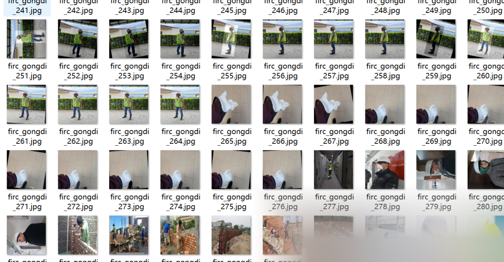
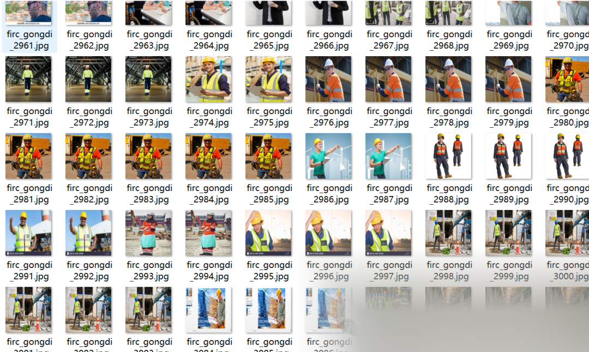
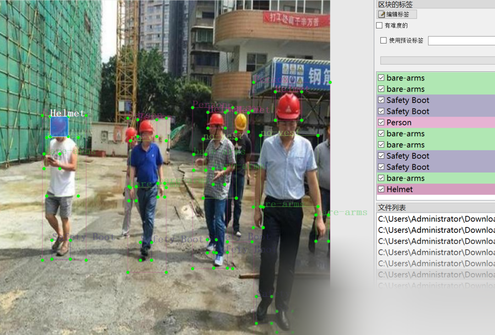

# Construction Site Behavior Detection Dataset VOC+YOLO format with 7958 images in 9 categories

Important Notice: The dataset contains many enhanced images. Please refer to the image preview for details.

Dataset format: Pascal VOC format + YOLO format (txt files without split paths, only containing jpg images and corresponding VOC format xml files and yolo format txt files)
Number of images (jpg file count): 7958
Number of annotations (xml file count): 7958
Number of annotations (txt file count): 7958
Number of annotation categories: 9
Annotation category names: ["Gloves", "Helmet", "Person", "Safety Boot", "Safety Vest", "bare-arms", "no-boot", "no-helmet", "no-vest"]
Number of boxes per category:
Gloves = 6826
Helmet = 15463
Person = 16349
Safety Boot = 10348
Safety Vest = 10382
bare-arms = 8028
no-boot = 651
no-helmet = 1666
no-vest = 5720
Total boxes: 75433
Using labelImg for annotation tool
Annotation rules: draw a box around the category
Special declaration: This dataset does not guarantee the accuracy or weights of the trained model or any other files. The dataset provides accurate and reasonable annotations only.

Image Preview:

Annotation example:

## Payment

Here is a pay link on Stripe ( https://buy.stripe.com/3cs8yP7sY87d0vu9AB ). Please contact me lonlonago@foxmail.com after funding $89, and I will send you a complete data files , thank you!

